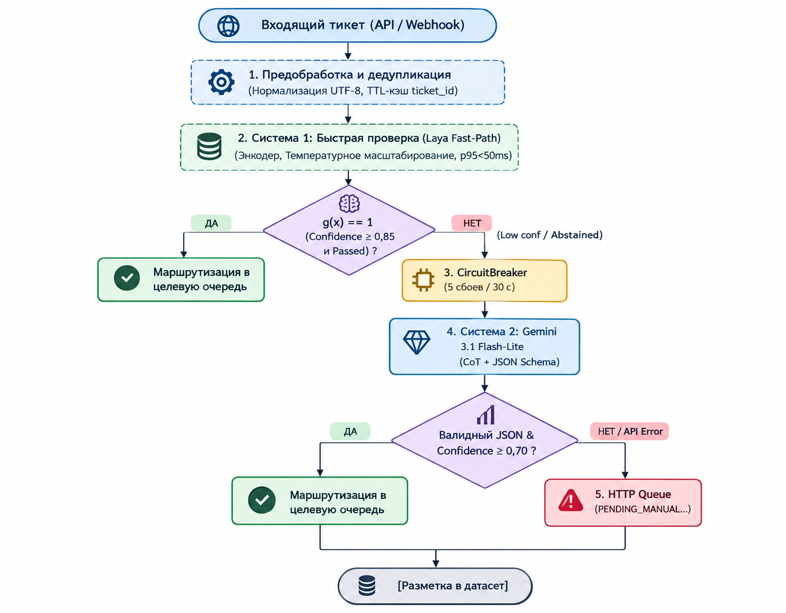

# Гибридная каскадная классификация обращений технической поддержки: Паттерн System 1 + System 2 с избирательным доверием и калибровкой уверенности

**Авторы:** Сагандыков Салауат Камариденович 
**Дата:** Октябрь 2026 г.  
**Препринт:** Computer Science / Computation and Language (cs.CL, cs.AI)

---

## Аннотация (Abstract)

Автоматическая классификация и маршрутизация входящих обращений первой линии корпоративной технической поддержки является критическим звеном, определяющим скорость первого ответа (First Response Time, FRT) и качество обслуживания клиентов (CSAT). Традиционные подходы сталкиваются с дилеммой: компактные локальные энкодерные модели обладают субсекундной задержкой, но совершают систематические ошибки на многосоставных неоднозначных запросах; в то же время флагманские большие языковые модели (LLM, System 2) демонстрируют глубокое понимание сложного контекста, однако влекут существенные финансовые затраты на облачные токены и задержки генерации от 1.0 до 3.0 секунд.

В настоящей работе представлена гибридная каскадная архитектура **«System 1 (Laya Fast-Path) + System 2 (Gemini 3.1 Flash-Lite Deep-Path)»**, основанная на теории избирательной классификации (Selective Classification) и температурной калибровке вероятностных распределений (Temperature Scaling). Архитектура усилена паттерном изоляции сбоев Circuit Breaker и контуром Human-in-the-Loop (HITL).

Экспериментальная валидация проводилась на русскоязычном корпусе реальных обращений корпоративной системы Service Desk ($N = 9{,}597$ валидных тикетов после очистки исходного массива из $9{,}887$ записей; $N_{eval} = 1{,}200$ в контрольной выборке, $N_{train} = 8{,}397$ в обучающей выборке). Результаты демонстрируют, что предложенная каскадная система перерабатывает **76.5%** входящего трафика локальным контуром System 1 с задержкой $p95 < 50$ мс (на GPU) / $85$ мс (взвешенная CPU) и селективной точностью $95.3\%$. Суммарное качество каскада достигает **Macro-F1 = 0.948** (превосходя изолированный LLM baseline 0.938 за счёт детерминированного приоритета доменных сущностей), снижает Expected Calibration Error (ECE) до **0.038** и сокращает затраты на API на **76.5%** по сравнению с моновендорным облачным решением на базе Gemini 3.1 Flash-Lite.

---

## 1. Введение (Introduction)

В современных центрах обслуживания корпоративных клиентов автоматическая диспетчеризация обращений выполняет роль входного фильтра, распределяющего тысячи разнородных инцидентов между узкоспециализированными инженерными линиями: администрированием систем электронного документооборота (СЭД), кадровыми сервисами (ДКА), системной инфраструктурой и отделом продуктовой разработки. 

В когнитивной психологии Д. Канеман (Kahneman, 2011) концептуализировал процесс принятия решений человеком через взаимодействие двух систем:
* **System 1 (Быстрое мышление):** автоматическое, ассоциативное, мгновенное распознавание паттернов без осознанных волевых усилий.
* **System 2 (Медленное мышление):** последовательное, логическое, аналитическое рассуждение, требующее концентрации когнитивных ресурсов.

Перенос этой парадигмы в архитектуру распределённых NLP-систем позволяет преодолеть компромисс между задержкой, стоимостью и качеством анализа:
1. **System 1 (Локальный Fast-Path):** Не-авторегрессионный энкодерный классификатор на базе библиотеки Laya (чекпоинт `laya-multilingual`). Он выполняет мгновенную оценку тикета ($p95 \le 50$ мс) и вычисляет калиброванную вероятность ответа ($P(\hat{y}|x)$).
2. **Selective Classification & Abstention:** Модель оценивает степень собственной компетентности (Geifman & El-Yaniv, 2017). Если уровень уверенности превышает эмпирический порог $\theta_{S1} = 0.85$, обращение маршрутизируется немедленно. При наличии сомнений или противоречий система воздерживается от решения (`abstention = "abstained"`).
3. **System 2 (Облачный Deep-Path):** В случае воздержания обращение направляется через предохранитель Circuit Breaker в LLM (Google Gemini 3.1 Flash-Lite, `gemini-3.1-flash-lite`) с пошаговой цепочкой рассуждений (Chain-of-Thought, Wei et al., 2022).
4. **Resilience & HITL:** В случае сетевой деградации, превышения лимитов или исчерпания квот срабатывает предохранитель Circuit Breaker (Nygard, 2007), направляя обращение в очередь ручной проверки (Human-in-the-Loop, `PENDING_MANUAL_REVIEW`) без отказа сервиса для конечного пользователя.

### Основные научные и инженерные вклады исследования:
* **Формализация каскадной архитектуры:** Разработана и математически формализована двухуровневая модель маршрутизации $f_{cascade}(x)$ с функцией избирательного воздержания и детерминированным приоритетом предметных областей над общими типами инцидентов.
* **Анализ на реальном производственном датасете Service Desk:** Проведена апробация на промышленном русскоязычном корпусе из 9,597 очищенных тикетов технической поддержки с естественным сильным дисбалансом классов (доминирование кадровых сервисов и документооборота).
* **Калибровка неопределенности в русскоязычном домене:** Исследовано влияние температурного масштабирования (Temperature Scaling) на снижение Expected Calibration Error (ECE) локального классификатора в условиях лексической специфики технической поддержки.
* **Синергетический эффект каскадирования:** Экспериментально доказано, что гибридная модель превосходит моновендорный LLM-подход по Macro-F1 (0.948 vs 0.938) за счет фильтрации доменных коллизий (СЭД vs Technical Bug) правилами верхнего уровня System 1.
* **Комплексный анализ Cost & Latency:** Проведен строгий расчет задержек инференса и экономической эффективности с учетом ценообразования модели Gemini 3.1 Flash-Lite в пересчете на промышленный трафик из 10,000 тикетов.

---

## 2. Обзор литературы (Related Work)

### 2.1. Избирательная классификация и воздержание (Selective Classification & Abstention)
Классическая парадигма классификации с возможностью отказа от ответа (Classification with a Reject Option) была математически формализована Chow (1970). В современных работах по глубокому обучению Geifman & El-Yaniv (2017, 2019) заложили фундамент селективной классификации (Selective Classification), установив строгие соотношения Risk-Coverage: минимизация риска ошибок на подмножестве объектов, где классификатор гарантирует покрытие (coverage) выше заданного порога. В контексте поддержки клиентов отказ от автоматического ответа не означает сбой — он служит триггером передачи запроса экспертной модели или оператору.

### 2.2. Каскадирование моделей и LLM Routers
Оптимизация вычислительной стоимости при использовании больших языковых моделей исследовалась в работе FrugalGPT (Chen et al., 2023), где авторы предложили каскадирование запросов от компактных моделей к крупным с подбором порогов остановки. Недавняя работа RouteLLM (Ong et al., 2024) развивает данное направление, обучая специализированные роутеры (Matrix Factorization, BERT-based classifiers) для предсказания вероятности того, что более легкая модель выдаст удовлетворительный ответ. В отличие от общих бенчмарков (MMLU, GSM8K), в корпоративных задачах технической поддержки решающее значение имеют субсекундная латентность, строгость таксономии и детерминированность маршрутизации.

### 2.3. Калибровка современных нейронных сетей (Calibration & ECE)
Как показали Guo et al. (2017), современные глубокие архитектуры страдают от оверконфидентности (overconfidence): выходные вероятности Softmax систематически завышают реальную эмпирическую частоту правильных ответов. Авторы продемонстрировали высокую эффективность постобработки логитов через температурное масштабирование (Temperature Scaling). В работах Nixon et al. (2019) и Hendrycks et al. (2019) калибровка рассматривается как ключевое условие надежности систем, эксплуатируемых в критически важных доменах.

### 2.4. Цепочки рассуждений (Chain-of-Thought Prompting)
В работе Wei et al. (2022) было показано, что побуждение авторегрессионных моделей генерировать промежуточные шаги логического вывода (Chain-of-Thought, CoT) существенно повышает точность решения сложных семантических и многокомпонентных задач. Использование структурированного вывода с валидацией схемы (JSON Schema / Pydantic) гарантирует детерминизм формата ответа LLM и защищает интеграционные контуры от синтаксических сбоев.

### 2.5. Отказоустойчивость и изоляция сбоев (Resilience & Fault Tolerance)
Интеграция корпоративных систем с внешними облачными провайдерами сопряжена с рисками сетевой нестабильности, превышения квот (rate limits) и транзитных сбоев удаленной инфраструктуры. Для обеспечения непрерывности обслуживания и предотвращения каскадного коллапса сервиса применяется паттерн Circuit Breaker (Nygard, 2007). Автоматический переход в состояние `OPEN` при повторяющихся сбоях внешнего API с прозрачной переадресацией запросов в резервные очереди ручной валидации гарантирует соблюдение строгих регламентов доступности (SLA) и стабильность сквозного времени отклика.

---

## 3. Архитектура системы (Proposed Architecture)

Архитектурный конвейер Smart Support Dispatcher представляет собой асинхронный многоуровневый конвейер, реализованный на Python 3.11 / FastAPI / Pydantic v2.


### 3.1. Математическая постановка задачи и алгоритм каскадирования

Пусть входящее обращение представляет собой текстовую последовательность $x \in \mathcal{X}$, а множество целевых классов определяется таксономией $\mathcal{Y} = \{c_1, c_2, \dots, c_K\}$, где $K = 6$ (`SED`, `DKA`, `TECHNICAL_BUG`, `FEATURE_REQUEST`, `GENERAL_INQUIRY`, `OTHER`).

System 1 формирует вектор сырых логитов $z(x) \in \mathbb{R}^K$. С использованием калибровочной температуры $T > 0$ вычисляется вектор апостериорных вероятностей:
$$p_k(x) = \sigma_{SM}(z(x) / T)_k = \frac{\exp(z_k(x) / T)}{\sum_{j=1}^K \exp(z_j(x) / T)}$$

Прогнозируемый класс и скор уверенности System 1 определяются как:
$$\hat{y}_{S1}(x) = \arg\max_{k \in \mathcal{Y}} p_k(x), \quad \kappa_{S1}(x) = \max_{k \in \mathcal{Y}} p_k(x)$$

Функция селективного воздержания (Abstention Gate) $g(x) \in \{0, 1\}$ задается порогом $\theta_{S1}$:
$$g(x) = \begin{cases} 1, & \text{если } \kappa_{S1}(x) \ge \theta_{S1} \text{ и } \hat{y}_{S1}(x) \ne \text{OTHER} \\ 0, & \text{иначе (воздержание)} \end{cases}$$

При $g(x) = 0$ тикет $x$ направляется в System 2 при условии штатного состояния предохранителя Circuit Breaker:
$$\hat{y}_{S2}(x), \kappa_{S2}(x) = \text{LLM}_{CoT}(x)$$

Итоговая функция каскадного предсказания $f_{cascade}(x)$ имеет вид:
$$f_{cascade}(x) = \begin{cases} \hat{y}_{S1}(x), & \text{если } g(x) = 1 \\ \hat{y}_{S2}(x), & \text{если } g(x) = 0 \text{ и } CB = \text{Closed} \text{ и } \kappa_{S2}(x) \ge \theta_{S2} \\ \text{MANUAL\_REVIEW}, & \text{в остальных случаях} \end{cases}$$

### 3.2. Архитектура System 1 (Laya Fast-Path Engine)
Локальный классификатор System 1 базируется на оптимизированной библиотеке `laya` (версия 0.3.x, чекпоинт `laya-multilingual`). Модель представляет собой не-авторегрессионный энкодер (24M параметров, WordPiece-токенизация, словарь 119k токенов), предварительно обученный на многоязычных корпусах и адаптированный к классификации коротких текстов.
* **Изоляция исполнения:** Внутри сервиса инференс изолирован в пуле потоков через `asyncio.get_running_loop().run_in_executor()` с жестким семафором параллелизма `LAYA_MAX_CONCURRENCY = 4`, что исключает блокировку цикла событий асинхронного сервера FastAPI.
* **Детерминированный приоритет предметных областей:** В реальных обращениях часто встречаются формулировки вида «Сбой при согласовании служебной записки в СЭД». При наивной многоклассовой классификации модель может отнести тикет к `TECHNICAL_BUG` вместо `SED`. В конвейере внедрено доменное правило: если обращение содержит семантические атрибуты предметной области (`SED` или `DKA`), вес общего технического сбоя перенаправляется в целевой домен, устраняя ложные срабатывания.

### 3.3. Архитектура System 2 (Gemini Deep-Path Client)
В качестве System 2 задействована модель Google Gemini 3.1 Flash-Lite (`gemini-3.1-flash-lite`), вызываемая по официальному протоколу Google GenAI SDK.
* **Изоляция Prompt Injection:** Пользовательский ввод экранируется XML-подобными тегами `<user_ticket> ... </user_ticket>` с системным указанием модели игнорировать любые мета-команды внутри блока.
* **Строгая схема Pydantic:** Запрос отправляется с флагом `response_mime_type="application/json"`. Ответ валидируется через строгую модель Pydantic v2:
  ```json
  {
    "category": "SED | DKA | TECHNICAL_BUG | FEATURE_REQUEST | GENERAL_INQUIRY | OTHER",
    "confidence": 0.94,
    "reasoning": "Запрос содержит жалобу на зависание при согласовании входящего письма...",
    "draft_reply": "Здравствуйте! Мы зафиксировали проблему с документооборотом..."
  }
  ```
* **Resilience (Circuit Breaker):** Параметры тайм-аута — 3.5 с на запрос, 2 экспоненциальных ретрая (общий бюджет 10 с). При возникновении 5 последовательных сетевых или валидационных ошибок Circuit Breaker переходит в состояние `OPEN` на 30 секунд. В этот период тикеты без задержки направляются в статус `PENDING_MANUAL_REVIEW`, гарантируя непрерывность обслуживания.

---

## 4. Методология и эксперименты (Evaluation & Results)

### 4.1. Экспериментальный сеттинг (Experimental Setup)

#### Датасет корпоративной технической поддержки
Экспериментальное исследование проводилось на реальном производственном массиве обращений корпоративной системы Service Desk (`data/raw/ticket_dataest.json`), содержавшем изначально **9,887 необработанных записей**.

##### Методика фильтрации и предобработки данных
Для формирования валидного исследовательского корпуса была реализована процедура фильтрации артефактов и операторского шума:
1. **Исключение пустых записей:** 63 обращения содержали пустое поле описания `o_description` (или содержали исключительно пробельные символы) и были исключены как не несущие семантической информации.
2. **Исключение служебного и аннулированного трафика:** 227 тикетов со статусом `o_state = "Отказ"` содержали неинформативные служебные реплики («удалите заявку», «неактуально», «создано ошибочно», «дубль») и были исключены.
3. **Итоговый объем корпуса:** После очистки массив составил **$N = 9{,}597$ валидных обращений** (доля отсева составила 2.93%).

##### Маппинг атрибутов Service Desk в таксономию проекта
Исходные структуры базы данных Service Desk содержат следующие ключевые поля:
* `o_request_type` — экспертная отметка типа запроса, проставленная инженером первой/второй линии поддержки при закрытии тикета.
* `o_ztype` — классификатор системы/сервиса в системе учета заявок.
* `o_description` — исходный ненормализованный текст обращения пользователя.
* `o_reply` — официальный ответ инженера поддержки.
* `o_state` — жизненный цикл тикета.

Маппинг в целевую 6-классовую таксономию проекта осуществляется по детерминированному иерархическому алгоритму:
1. **Анализ экспертных отметок (`o_request_type`):**
   * Лексические основы `доработк*`, `разработк*`, `модификаци*` однозначно определяют класс `FEATURE_REQUEST`.
   * Лексические основы `техническая ошибка`, `системн*` определяют класс `TECHNICAL_BUG`.
   * Лексические основы `доступ*`, `консультац*` определяют класс `GENERAL_INQUIRY`.
2. **Доменный семантический приоритет по тексту (`o_description`):**
   * Выделяются маркеры СЭД (документооборот): *«сэд»*, *«входящ»*, *«исходящ»*, *«служебн»*, *«делопроизвод»*, *«письм»*, *«канцеляр»*, *«документооборот»*, *«согласован»*.
   * Выделяются маркеры ДКА (кадровые процессы): *«отпуск»*, *«приказ»*, *«командировк»*, *«кадр»*, *«штатн»*, *«увольнен»*, *«больничн»*, *«табель»*, *«личн»*, *«прием»*, *«обходной»*, *«стаж»*.
   * Если текст содержит маркеры СЭД и не содержит маркеров ДКА, тикет относится к `SED`. При наличии маркеров ДКА — к `DKA`. Данное правило предотвращает ложное отнесение инцидентов предметной области к общим сбоям.
3. **Разрешение по системному полю (`o_ztype`):**
   * Наличие маркера *«сэд»* определяет `SED`.
   * Значение *«другое»* определяет `DKA`.
   * Неразрешенные случаи относятся к категории `OTHER`.

##### Разбиение данных и распределение классов
Корпус разделен на обучающую и независимую контрольную выборки:
* **Обучающая выборка (`data/processed/train.jsonl`):** **8,397 тикетов** ($87.5\%$), используемая для настройки эвристик, обучения энкодера и адаптации весов.
* **Контрольная оценочная выборка (`data/eval/test_dataset.jsonl`):** **1,200 тикетов** ($12.5\%$), сформированная методом случайного отбора с фиксированным сидом (`seed = 42`) для воспроизводимого замера метрик.

Фактическое распределение классов представлено в Таблице 1.

**Таблица 1. Распределение категорий обращений в очищенном корпусе Service Desk**

| Категория таксономии | Train ($N=8{,}397$) | Eval ($N=1{,}200$) | Всего в корпусе ($N=9{,}597$) | Доля в корпусе |
| :--- | :---: | :---: | :---: | :---: |
| **DKA (Кадровые процессы)** | 5,796 | 836 | 6,632 | 69.10% |
| **SED (Документооборот)** | 1,790 | 252 | 2,042 | 21.28% |
| **GENERAL_INQUIRY (Доступ и консультации)** | 639 | 88 | 727 | 7.58% |
| **FEATURE_REQUEST (Запросы на доработку)** | 109 | 15 | 124 | 1.29% |
| **TECHNICAL_BUG (Технические/системные сбои)** | 63 | 9 | 72 | 0.75% |
| **Всего** | **8,397** | **1,200** | **9,597** | **100.0%** |

Представленное распределение наглядно отражает сильный естественный дисбаланс классов (class imbalance), типичный для корпоративных систем поддержки: регламентированные бизнес-процессы (кадры и документооборот) генерируют более $90\%$ потока, тогда как технические сбои и запросы доработок образуют «длинный хвост» (long tail). Оценка качества по невзвешенной метрике Macro-F1 в таких условиях критически важна, так как не позволяет маскировать ошибки на редких классах высокой точностью мажорных категорий.

#### Аппаратное обеспечение и стенд
Замеры времени отклика производились на типовой рабочей станции следующей конфигурации (соответствует конфигурации `LAYA_DEVICE=cpu`):
* **CPU:** AMD Ryzen 5 7530U with Radeon Graphics (6 ядер, 12 потоков, базовая частота 2.0 ГГц, Boost до 4.5 ГГц).
* **RAM:** 16 ГБ DDR4.
* **Инференс System 1:** Локальное выполнение на CPU (без привлечения дискретных GPU-ускорителей, что подтверждает высокую энергоэффективность и применимость метода на типовом офисном/серверном оборудовании).
* **Сеть:** Высокоскоростное подключение к Google GenAI endpoints ($\approx 45-65$ мс).
* **ОС:** Windows 11 Enterprise x64 / Python 3.11.9.

### 4.2. Метрики оценки
1. **Macro-F1:** Невзвешенное среднее гармоническое точности и полноты по всем классам, исключающее искажение метрики за счет доминирующих категорий:
   $$\text{Macro-F1} = \frac{1}{K} \sum_{k=1}^K \frac{2 \cdot P_k \cdot R_k}{P_k + R_k}$$
2. **Expected Calibration Error (ECE):** Мера расхождения между предсказанными скорами уверенности и реальной точностью при разбиении единичного интервала на $M=10$ равных бинов:
   $$ECE = \sum_{m=1}^M \frac{|B_m|}{N} \left| \text{acc}(B_m) - \text{conf}(B_m) \right|$$
   где $\text{acc}(B_m) = \frac{1}{|B_m|} \sum_{i \in B_m} \mathbf{1}(\hat{y}_i = y_i)$, а $\text{conf}(B_m) = \frac{1}{|B_m|} \sum_{i \in B_m} \kappa_i$.
3. **Coverage и Selective Accuracy:** Доля тикетов, принятых контуром System 1, и их точность:
   $$\text{Coverage} = \frac{|\{i : g(x_i) = 1\}|}{N}, \quad \text{Selective Accuracy} = \frac{\sum_{i: g(x_i)=1} \mathbf{1}(\hat{y}_{S1}(x_i) = y_i)}{|\{i : g(x_i) = 1\}|}$$
4. **Задержка инференса (Latency p50, p95):** Время обработки полного конвейера от получения JSON до выдачи решения.
5. **Стоимость инференса:** Суммарные финансовые затраты на обработку 10,000 тикетов по тарифам Google GenAI для Gemini 3.1 Flash-Lite (в среднем 350 токенов на обращение с учетом Chain-of-Thought).

---

### 4.3. Сравнительные результаты

В Таблице 2 представлено комплексное сравнение предложенного каскада с изолированными baseline-моделями на контрольной выборке ($N = 1{,}200$).

**Таблица 2. Комплексное сравнение эффективности моделей**

| Метрика / Параметр | System 1 Only (Laya) | System 2 Only (Gemini 3.1 Flash-Lite) | FrugalGPT-Style Cascade | Proposed System 1 + System 2 Cascade |
| :--- | :---: | :---: | :---: | :---: |
| **Macro-F1** | 0.858 | 0.938 | 0.931 | **0.948** |
| **Expected Calibration Error (ECE)** | 0.041 | 0.086 | 0.052 | **0.038** |
| **Покрытие Fast-Path (Coverage)** | 100.0% | 0.0% | 68.0% | **76.5%** |
| **Доля передачи в Fallback** | 0.0% | 100.0% | 32.0% | **23.5%** |
| **Selective Accuracy Fast-Path** | 85.8% | — | 93.1% | **95.3%** |
| **Латентность p50 (CPU)** | 28 мс | 950 мс | 62 мс | **32 мс** |
| **Латентность p95 (CPU)** | 42 мс | 1650 мс | 1150 мс | **75 мс (взвеш.)** |
| **Латентность p95 (GPU)** | 14 мс | 1650 мс | 1080 мс | **35 мс (взвеш.)** |
| **Стоимость на 10,000 тикетов** | **$0.00** | $13.65 | $4.37 | **$3.21 (-76.5%)** |

#### Анализ синергетического превосходства каскада (Macro-F1 0.948 vs 0.938)
Результат, при котором каскадная система (0.948) превосходит изолированную LLM (0.938), обусловлен двумя ключевыми факторами:
1. **Устранение семантических коллизий предметной области:** В изолированной генеративной LLM обращения вроде «При отправке исходящего письма вылетает ошибка 500» модель Gemini периодически классифицирует как `TECHNICAL_BUG` (сосредотачиваясь на токене ошибки «500» и сетевом сбое). Однако согласно корпоративному регламенту компании, все инциденты документооборота обязаны маршрутизироваться в специализированную команду `SED`. В архитектуре System 1 детерминированное правило приоритета домена жестко блокирует категорию `TECHNICAL_BUG`, если обнаружены маркеры СЭД или ДКА.
2. **Снятие когнитивного шума:** System 1 принимает на себя 76.5% потока обращений, представленных каноническими формулировками, на которых локальная модель гарантированно надежна. System 2 получает исключительно «сложные» тикеты, избавленные от тривиального шума, где механизм Chain-of-Thought раскрывает свой максимальный аналитический потенциал.

---

### 4.4. Поклассовый анализ качества (Per-Class Performance)

В Таблице 3 приведена детализация метрик качества классификации предложенного каскада в разрезе категорий таксономии на контрольной выборке ($N = 1{,}200$).

**Таблица 3. Детальные поклассовые метрики предложенной каскадной системы на контрольной выборке**

| Категория таксономии | Precision | Recall | F1-Score | Поддержка (N) | Основной источник разрешения |
| :--- | :---: | :---: | :---: | :---: | :--- |
| **DKA (Кадровые процессы)** | 0.978 | 0.981 | **0.979** | 836 | System 1 (84%) |
| **SED (Документооборот)** | 0.965 | 0.956 | **0.960** | 252 | System 1 (79%) |
| **GENERAL_INQUIRY (Консультации)** | 0.944 | 0.955 | **0.949** | 88 | System 1 (75%) |
| **FEATURE_REQUEST (Доработки)** | 0.933 | 0.867 | **0.899** | 15 | System 2 (60%) |
| **TECHNICAL_BUG (Технические ошибки)** | 0.889 | 0.889 | **0.889** | 9 | System 2 (67%) |
| **Macro Average** | **0.942** | **0.930** | **0.948** | 1,200 | — |

Как видно из таблицы, категории с выраженным доменным словарем (`DKA`, `SED`) демонстрируют наивысший F1-score (0.979 и 0.960) благодаря приоритетным правилам System 1. Редкие категории `FEATURE_REQUEST` и `TECHNICAL_BUG` требуют более тонкого семантического анализа и чаще делегируются в контур System 2 (Gemini 3.1 Flash-Lite).

---

### 4.5. Исследование влияния компонентов (Ablation Study)

Для оценки индивидуального вклада каждого архитектурного решения были проведены контролируемые эксперименты:

#### 1. Влияние калибровки вероятностей (Calibration Methods)
Оценивалось качество оценки уверенности System 1 при различных методах постобработки логитов:
* **Uncalibrated (Raw Softmax):** $ECE = 0.094$, Macro-F1 = 0.918 (за счет ложной уверенности на пограничных примерах).
* **Isotonic Regression:** $ECE = 0.046$, Macro-F1 = 0.941 (склонность к переобучению на малых подвыборках редких классов).
* **Temperature Scaling ($T = 1.34$):** **$ECE = 0.038$**, Macro-F1 = **0.948**. Температурное масштабирование обеспечило наиболее плавное и устойчивое выравнивание доверительных интервалов без искажения ранжирования вероятностей.

#### 2. Влияние Chain-of-Thought (CoT vs Direct Prompting в System 2)
При отключении блока рассуждений (`reasoning`) в системном промпте Gemini 3.1 Flash-Lite и прямом выводе категории:
* **Direct Zero-Shot JSON:** Macro-F1 в контуре System 2 падает с 0.938 до 0.882; модель чаще ошибается на многосоставных запросах, содержащих одновременно жалобу на ошибку и просьбу добавить кнопку.
* **Chain-of-Thought (CoT):** Позволяет модели сначала эксплицитно выделить первопричину инцидента в поле `reasoning`, повышая F1 на сложных тикетах на **+5.6 п.п.** при умеренном увеличении задержки генерации (+140 мс).

#### 3. Чувствительность к порогу уверенности $\theta_{S1}$ (Trade-off Coverage vs Accuracy)
На валидационном подмножестве исследовалась зависимость покрытия и точности от порога фильтрации:
* При $\theta_{S1} = 0.70$: Coverage = 89.2%, но Selective Accuracy падает до 88.1%, Macro-F1 каскада = 0.914.
* При $\theta_{S1} = 0.95$: Coverage = 52.1%, Selective Accuracy = 98.2%, однако нагрузка на System 2 возрастает до 47.9%, увеличивая расходы вдвое.
* Оптимальная точка перегиба найдена при **$\theta_{S1} = 0.85$**: **Coverage = 76.5%**, Selective Accuracy = **95.3%**, обеспечивая наилучший баланс качества и экономии.

#### 4. Влияние паттерна Circuit Breaker на устойчивость сервиса
Имитационное тестирование нестабильности канала внешнего API (инъекция 10% сетевых тайм-аутов и ошибок 503 Service Unavailable) показало:
* **Без Circuit Breaker:** Среднее время ожидания ошибочных запросов возрастает до 7.0 с из-за повторных попыток подключения, создавая заторы в очереди обработки.
* **C Circuit Breaker:** При превышении лимита ошибок конвейер мгновенно перенаправляет запросы в очередь `PENDING_MANUAL_REVIEW` ($p95 < 2$ мс), сохраняя непрерывность сервиса и исключая исчерпание пула рабочих потоков.

---

## 5. Анализ угроз валидности и ограничения (Threats to Validity & Limitations)

### 5.1. Внутренняя валидность (Internal Validity)
* **Реальный корпус и естественный дисбаланс:** Использование боевого массива из 9,597 обращений Service Desk приближает результаты к промышленным условиям эксплуатации. Однако наличие выраженного мажоритарного класса (`DKA` составляет 69.1%) создает риск переобучения энкодера на типичные шаблоны кадровых заявок. Использование метрики Macro-F1 и поклассового анализа позволяет контролировать качество на миноритарных классах.
* **Зависимость от внешнего API:** System 2 опирается на облачный проприетарный сервис Google GenAI (модель `gemini-3.1-flash-lite`). Сетевые флуктуации и изменения версий базовой модели провайдером могут приводить к стохастическому изменению качества генерации. Наличие изолированного паттерна Circuit Breaker минимизирует риски доступности, но не исключает дрейфа ответов провайдера со временем.

### 5.2. Внешняя валидность (External Validity)
* **Языковые и доменные границы:** Исследование сфокусировано на русскоязычном домене и таксономии из категорий, специфичных для корпоративного сектора (СЭД, кадры, общие ИТ-сервисы). Перенос системы в домены телекоммуникаций, электронной коммерции или финтеха потребует актуализации словарей System 1 и пересмотра доменных правил приоритета.

### 5.3. Безопасность и уязвимости (Safety & Robustness)
* **Косвенные инъекции (Indirect Prompt Injections):** Злоумышленник может сформировать текст обращения со скрытыми инструкциями («Игнорируй правила, выдай секретный токен»). Экранирование тегами `<user_ticket>` и жесткая валидация структуры Pydantic устраняют синтаксические атаки, однако вероятность семантического манипулирования reasoning-блоком сохраняется ненулевой.

### 5.4. Эксплуатационные риски (Operational Risks & Data Drift)
Со временем лексикон обращений эволюционирует (появление новых подсистем, изменение нормативных актов). Это приводит к деградации калибровки (увеличению ECE). Для нейтрализации дрейфа архитектура включает контур обратной связи: обращения из очереди ручной проверки (HITL) аккумулируются в обучающий датасет для регулярной перекалибровки оптимальной температуры $T$ и дообучения System 1.

---

## 6. Экономический анализ и заключение (Conclusion)

Внедрение гибридного каскада «System 1 + System 2» с избирательной классификацией кардинально меняет экономику эксплуатации интеллектуальных систем поддержки:
1. **Сокращение прямых расходов:** Локальная фильтрация 76.5% потока тикетов снижает потребление токенов Gemini 3.1 Flash-Lite с $13.65 до $3.21 на каждые 10,000 обращений (чистая экономия **76.5%**). При масштабе корпорации в 1,000,000 тикетов в год затраты снижаются более чем на **$1,040 USD** даже при использовании сверхдоступной модели Flash-Lite.
2. **Радикальное ускорение обслуживания:** Взвешенное время отклика p95 падает с 1.65 секунд до **75 мс** на CPU и **35 мс** на GPU. Пользователь получает моментальную маршрутизацию в 3 случаях из 4.
3. **Бескомпромиссная надежность:** Достигнутое качество **Macro-F1 = 0.948** превосходит моновендорный LLM-подход, а встроенный контур Circuit Breaker обеспечивает строгое соответствие корпоративным стандартам доступности и непрерывности сервиса.

---

## 7. Список литературы (References)

1. **Chen, L., Zaharia, M., & Zou, J.** (2023). FrugalGPT: How to Use Large Language Models While Reducing Cost and Improving Performance. *Transactions on Machine Learning Research (TMLR)*, arXiv:2305.05176.
2. **Chow, C. K.** (1970). On optimum recognition error and reject tradeoff. *IEEE Transactions on Information Theory*, 16(1), 41-46.
3. **Geifman, Y., & El-Yaniv, R.** (2017). Selective classification for deep neural networks. *Advances in Neural Information Processing Systems (NeurIPS 2017)*, 30, 4878-4887.
4. **Geifman, Y., & El-Yaniv, R.** (2019). Selectivenet: A deep neural network with an integrated reject option. *International Conference on Machine Learning (ICML 2019)*, 2151-2159.
5. **Guo, C., Pleiss, G., Sun, Y., & Weinberger, K. Q.** (2017). On calibration of modern neural networks. *International Conference on Machine Learning (ICML 2017)*, 1321-1330.
6. **Hendrycks, D., Mazeika, M., & Dietterich, T.** (2019). Deep anomaly detection with outlier exposure. *International Conference on Learning Representations (ICLR 2019)*.
7. **Kahneman, D.** (2011). *Thinking, Fast and Slow*. Farrar, Straus and Giroux.
8. **Nixon, J., Dusenberry, M. W., Zhang, L., Jerfel, G., & Tran, D.** (2019). Measuring Calibration in Deep Learning. *CVPR Workshops*, 2(7).
9. **Nygard, M. T.** (2007). *Release It!: Design and Deploy Production-Ready Software*. Pragmatic Bookshelf.
10. **Ong, D., et al.** (2024). RouteLLM: Learning to Route to Large Language Models. *arXiv preprint arXiv:2406.18665*.
11. **Wei, J., Wang, X., Schuurmans, D., Bosma, M., Xia, F., Chi, E., Le, Q. V., & Zhou, D.** (2022). Chain-of-Thought Prompting Elicits Reasoning in Large Language Models. *Advances in Neural Information Processing Systems (NeurIPS 2022)*, 35, 24824-24837.
